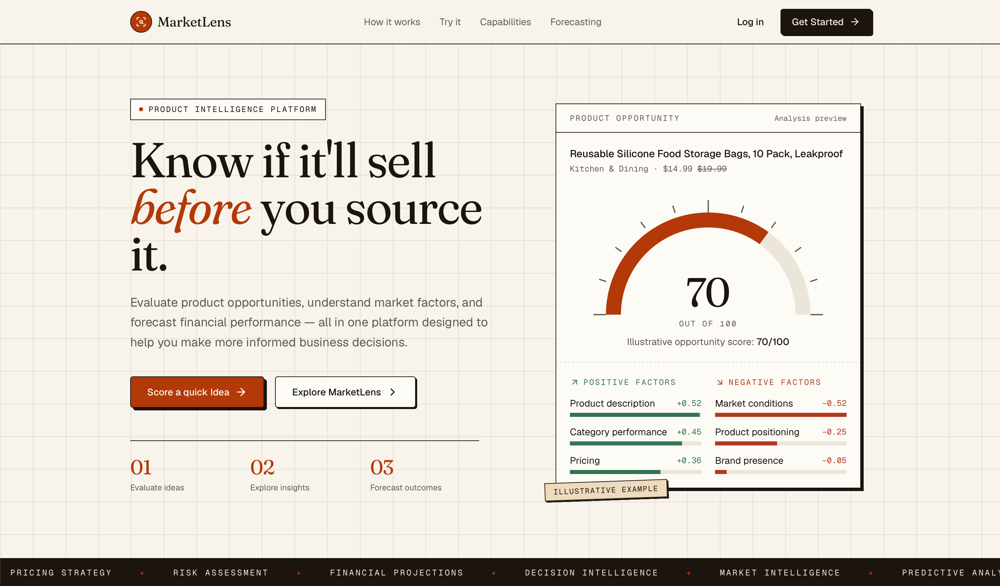
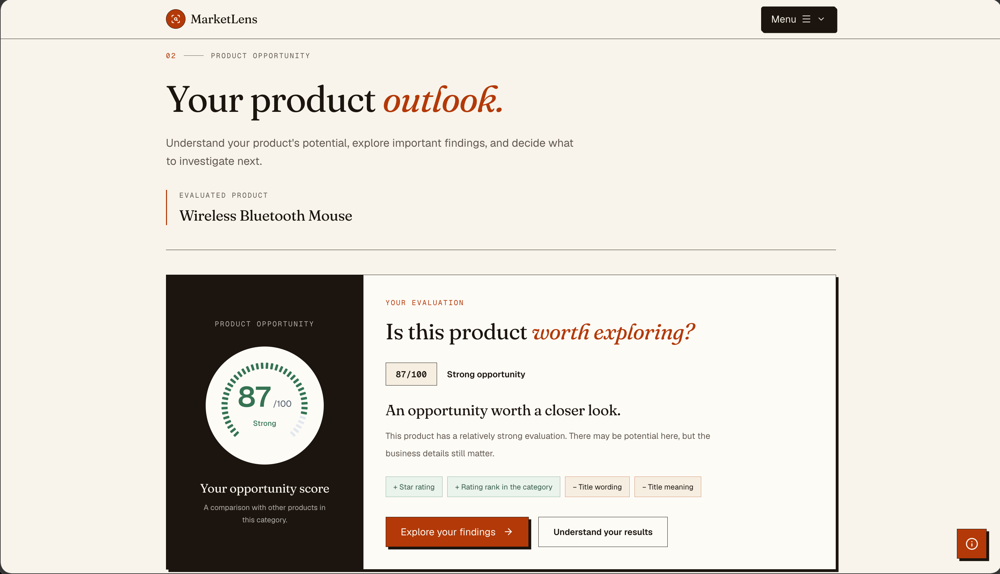
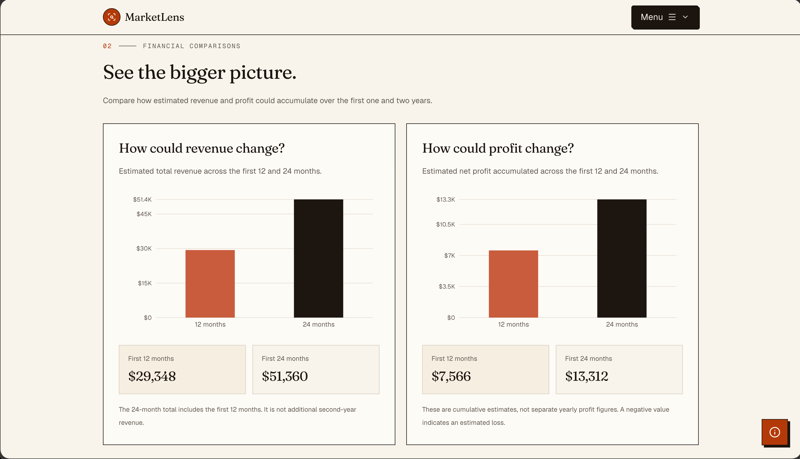

 <h1 align="center">MarketLens</h1>

<p align="center">
  Product intelligence and financial forecasting for Amazon sellers.
</p>

<p align="center">
  <a href="#overview">Overview</a> ·
  <a href="#features">Features</a> ·
  <a href="#technology">Technology</a> ·
  <a href="#getting-started">Getting Started</a> ·
  <a href="#contributing">Contributing</a>
</p>



## Overview

MarketLens helps Amazon sellers evaluate product opportunities before investing in inventory.

The platform combines machine learning, opportunity scoring, and financial forecasting to help users assess product potential, understand market factors, and estimate launch performance.

## Features

### Product Opportunity Scoring

Evaluate product ideas with an opportunity score from 0 to 100, compared against other products in the same category.

MarketLens highlights factors that contribute positively or negatively to a product's score, helping users understand the evaluation.

<p align="center">
  
</p>

### Financial Forecasting

Estimate potential revenue, profit, margins, ROI, and break-even performance before launching a product.

Explore launch forecasts and compare financial projections across 12-month and 24-month periods.

<p align="center">
  
</p>

### Other Features

- **Product Discovery** — Browse supported products and explore potential opportunities.
- **Score Explanations** — Understand the product characteristics influencing an opportunity score.
- **Launch Feasibility** — Evaluate estimated financial performance and launch considerations.
- **Monthly and Yearly Forecasts** — Explore financial predictions for supported catalogue products.
- **User Authentication** — Create an account and sign in with Firebase Authentication.

## Technology

| Component | Technologies |
| --- | --- |
| Frontend | React, JavaScript, Vite, Tailwind CSS |
| UI | React Router, Recharts, Lucide React, Motion |
| Authentication | Firebase Authentication |
| Backend | Python, FastAPI |
| Machine Learning | XGBoost, scikit-learn, Pandas, NumPy |
| Model Serving | ONNX Runtime, Google Cloud Run |

## Getting Started

### Prerequisites

- Git
- Node.js and npm
- Python for local backend development

### Installation

Clone the repository.

```bash
git clone https://github.com/aisutd/marketlens.git
cd marketlens
```

Install the frontend dependencies.

```bash
cd frontend
npm install
```

### Environment Configuration

Copy the example environment file.

```bash
cp .env.example .env.local
```

To enable account features, configure Firebase Authentication using the environment variables described in the [frontend documentation](frontend/README.md).

The landing page and anonymous demo can run without Firebase configuration. Account features require a configured Firebase project.

### Running the Frontend

From the `frontend/` directory:

```bash
npm run dev
```

Open the local URL displayed in your terminal, typically `http://localhost:5173`.

The frontend uses a Vite development proxy to communicate with the backend services. Backend-dependent functionality requires the corresponding services to be available.

For additional configuration, see the [frontend development guide](frontend/README.md).

## Backend Services

MarketLens uses two separate FastAPI services for product evaluation and financial forecasting.

### Product Success API

The product success model evaluates product ideas using an XGBoost classifier and generates opportunity scores with explanations.

The scoring API is deployed on Google Cloud Run.

- [API Documentation](https://marketlens-api-643561615020.us-central1.run.app/docs)
- [Product Success Developer Guide](product_success/README.md)

Local development requires the appropriate Python dependencies, model artifacts, and authentication configuration for protected endpoints.

### Sales Forecasting API

The sales forecasting service provides launch, monthly, and yearly financial predictions for supported products.

Predictions include estimated sales, revenue, profit, margins, ROI, and break-even performance.

- [Sales Forecasting Developer Guide](sales_forecast/README.md)

The service runs locally on port `8000` by default. Follow its developer guide to configure dependencies, restore model files, and start the API.

**Data limitations:** Financial forecasting models were trained using simulated sales, cost, and historical data derived from an Amazon product dataset. Reported error ranges are based on held-out model evaluations and are not guaranteed confidence intervals. Real-world forecasting accuracy has not been established.

## Project Structure

```text
marketlens/
├── docs/
│   └── screenshots/
│       ├── landing.png
│       ├── opportunity-score.png
│       └── forecasting.png
├── frontend/
├── product_success/
├── sales_forecast/
├── docker-compose.yml
└── README.md
```

| Directory | Description |
| --- | --- |
| [`frontend/`](frontend/README.md) | React web application, authentication, and user interface |
| [`product_success/`](product_success/README.md) | Opportunity scoring model and FastAPI service |
| [`sales_forecast/`](sales_forecast/README.md) | Financial forecasting models and FastAPI service |
| `docs/screenshots/` | Screenshots used in this README |

Each component maintains its own documentation, dependencies, and development instructions.

## Development

### Frontend

From the `frontend/` directory:

```bash
npm run lint
npm run build
npm run check:categories
npm run check:score-factors
npm run test:price-history
```

### Product Success

From the repository root, with the appropriate Python dependencies installed:

```bash
pytest product_success/api/tests
```

See the [Product Success README](product_success/README.md) for additional setup and testing instructions.

### Sales Forecasting

From the `sales_forecast/` directory:

```bash
python -m pytest -q
```

See the [Sales Forecasting README](sales_forecast/README.md) for model tests, API tests, and example predictions.

### Docker

The root `docker-compose.yml` currently defines a placeholder development container. It does not start the frontend or either backend API.

Use the component-specific instructions to run the application locally.

## Contributing

Contributions are welcome.

1. Create a new branch from the latest `main`.
2. Keep changes focused on the relevant project component.
3. Run applicable lint checks, builds, and tests.
4. Open a pull request targeting `main`.

Do not commit credentials, local environment files, datasets, or trained model artifacts.

Keep component-specific changes within their respective directories and consult the relevant README before modifying backend services.